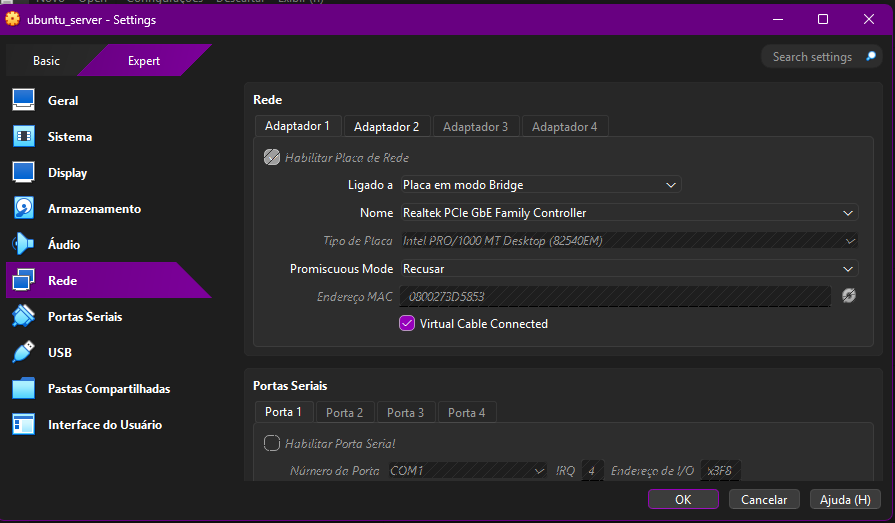
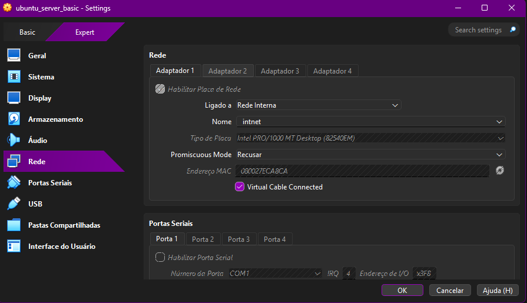
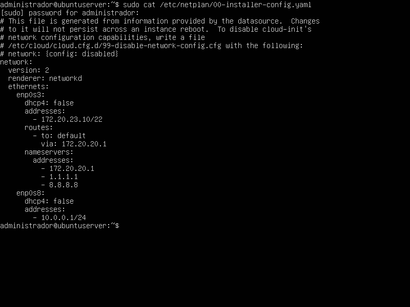
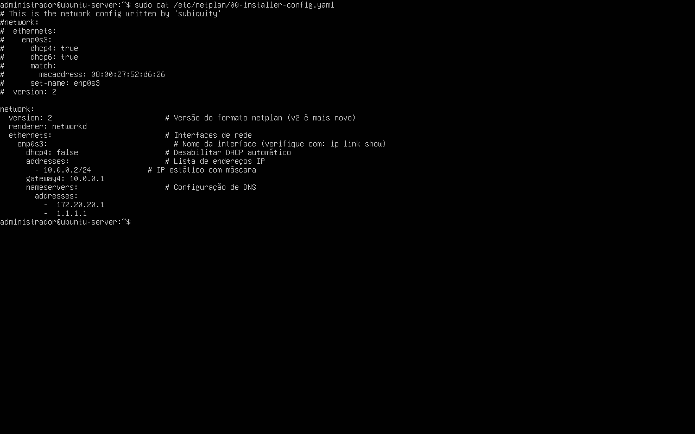
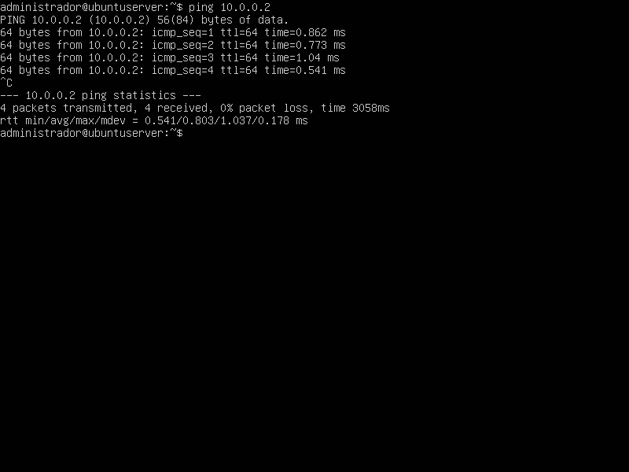
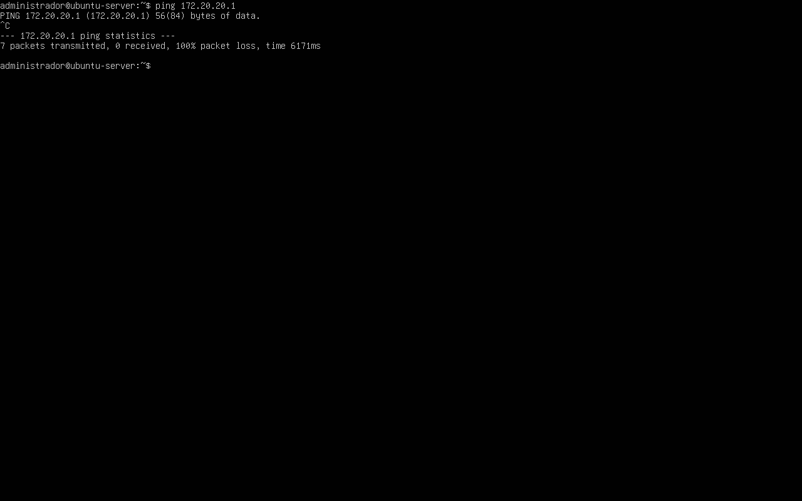

## 1. Identificação
* **Disciplina:** Laboratório de Sistemas Operacionais e Redes (LSOR)
* **Curso:** Bacharelado em Sistemas de Informação (BSI)
* **Repositório:** `labredes-bsi-2026.02`
* **Estudante:** José Pedro Costa Duda
* **Data da Execução:** 23/08/2026

---

## 2. Objetivo
O objetivo desta atividade é transformar a atual configuração de rede da máquina virtual (Modo NAT) para o modo de Placa em Bridge, que permite
que a máquina virtual faça parte direta da rede física do laboratório. Além disso, faremos a configuração do arquivo netplan responsável por 
configurar, entre muitas coisas, o IP estático da nossa VM.

---

## 3. Ambiente do Laboratório

* **Computador Host:**
  * **Sistema Operacional:** Windows
  * **Caminho da VM:** `C:\2026\BSI\VM\José Pedro Costa Duda\ubuntu_server`
  * **Arquivo ISO Utilizado:** `ubuntu-26.04-live-server-amd64.iso`
  
* **Máquina Virtual 1:**
  * **Software de Virtualização:** Oracle VM VirtualBox
  * **Nome da VM:** `ubuntu_server`
  * **Memória RAM:** 2048 MB
  * **CPU:** 1 CPU
  * **Disco Virtual:** 32 GB (VDI, Dinamicamente Alocado)
  * **Placas de Rede:** 2 placas de rede
    
* **Máquina Virtual 2:**
  * **Software de Virtualização:** Oracle VM VirtualBox
  * **Nome da VM:** `ubuntu_server-basic`
  * **Memória RAM:** 2048 MB
  * **CPU:** 1 CPU
  * **Disco Virtual:** 32 GB (VDI, Dinamicamente Alocado)
  * **Placas de Rede:** 1 placa de rede

---

## 4. Procedimento Realizado

### 4.1. **Configuração das placas de rede:** 
  Nas configurações de cada máquina virtual foram atualizadas as funcionalidades. Para a máquina virtual 1 foi criado dois adaptadores de rede, sendo a primeira em modo bridge
  (para se comunicar com a rede externa do IFAL) e uma placa em modo de rede interna (visando a comunicação com a segunda máquina virtual). Já na segunda máquina ocorre somente a criação de 1 
  placa de em modo de rede interna.
  
### 4.2. **Configuração do netplan (VM 1):** 
Utilizando o editor nano da máquina virtual, foi realizado a alteração do arquivo '.yaml' presente no diretório /etc/netplan, mudando informações 
como: endereço de IP da máquina virtual, a máscara de sub-rede, o Gateway Padrão e servidores DNS. Ao fim do arquivo, foi adicionado uma nova conexão 
'enp0s8' com 'dhcp4' false e o IP '10.0.0.1/24'.

### 4.3. **Configuração do netplan (VM 2):** 
Da mesma forma que o passo anterior, o arquivo '.yaml' presente no diretório /etc/netplan da máquina virtual foi alterado levando em consideração as configurações
propostas na atividade do laboratório.
  
### 4.4. **Aplicação de regras:**
  Após a visualização do arquivo devidamente editado, foi utilizado o comando 'netplan apply' para garantir essa nova configuração de rede. O passo foi executado em
  ambas as máquinas virtuais logo após a alteração e checagem dos arquivos.
  
---

## 5. Testes e Evidências

### 5.1. Configuração de rede (VM 1):

---

### 5.2. Configuração de rede (VM 2):

---

### 5.3. Arquivos netplan:

---

### 5.4. Teste de 'Ping' (VM 2 > VM 1):

---

### 5.5. Teste de 'Ping' (VM 1 > VM 2):

---

### 5.6. Teste de Ping (VM2 > Host Windows):

---

## 6. Problemas Encontrados e Soluções

* **Problema:** Nenhum problema encontrado na prática desta atividade.
* **Solução:** ----

---

## 7. Conclusão
Ao fim da atividade foi possível perceber que o uso do roteamento NAT (Network Adress Translation) é importante por permitir que os dispositivos
de uma rede interna consigam interagir com outras redes, como a internet, atráves de endereços de IP traduzidos. Além disso, diminui a necessidade
de endereços IPv4 (todos os dispositivos de uma rede privada compartilham um único IP público) e esconde os IPs internos de cada dispositivo dessa 
rede privada (dificultando que sistemas externos identifiquem a estrutura dessa rede).
